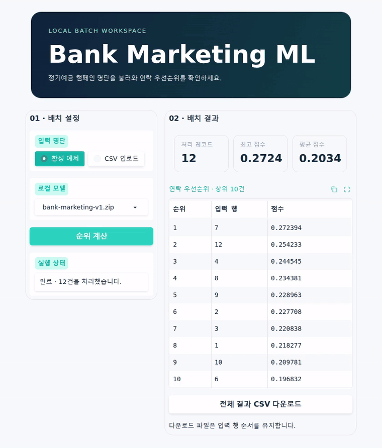

# Bank Marketing ML

**정기예금 캠페인에서 누구에게 먼저 연락할지 정하는 배치 순위 모델.**

CSV 명단을 넣으면 Logistic Regression이 예정된 연락 직전의 정보를 바탕으로 점수와 순위를 계산한다. Gradio에서 상위 후보를 확인하고 전체 결과를 내려받을 수 있다. [UCI Bank Marketing 데이터셋](https://archive.ics.uci.edu/dataset/222/bank+marketing)

[시연](#demo) · [평가 결과](#results) · [빠른 실행](#quick-start) · [MLOps 실행 가이드](docs/mlops.md)

## Demo



합성 명단을 처리해 상위 10건을 확인하고, 전체 결과를 CSV로 내려받는 흐름이다. 필수 열이 누락된 CSV를 넣었을 때는 실행 상태에 원인이 표시된다.

### Local Dashboard

[모델 ZIP을 준비](#2-prepare-the-model)한 뒤 프로젝트 루트에서 실행한다.

```bash
uv run --locked --group ui python scripts/run_dashboard.py
```

[로컬 대시보드](http://127.0.0.1:7860)에서 **합성 예제 → 순위 계산**을 선택한다. 직접 준비한 명단은 **CSV 업로드**에서 최대 5 MB까지 올릴 수 있다. 모델은 `models/`에 보관한 호환 ZIP에서 선택한다. 포트가 사용 중이면 `--port 7861`을 추가한다.

## Results

**Test 상위 10%에 가입 레코드 211건이 포함됐다.** 상위 412건의 가입 비율은 51.2%로, 전체 Test 가입 비율 45.9%의 약 1.11배였다.

| 지표 | Validation | Final Test |
|---|---:|---:|
| Average Precision | 0.288234 | 0.549042 |
| ROC-AUC | 0.688023 | 0.620009 |
| Precision@10% | 0.375000 | 0.512136 |
| Recall@10% | 0.270578 | 0.111522 |
| Lift@10% | 2.705123 | 1.114951 |
| 전체 가입 비율 | 13.86% | 45.93% |

Validation과 Test의 가입 비율이 크게 달라 AP 차이만으로 성능 개선을 판단하기 어렵다. 후기 기간의 Lift@10%는 약 1.11로 순위 성능이 제한적이었다. 결과는 캠페인 레코드 단위이며, 실제 연락의 인과효과나 수익성은 별도 검증이 필요하다. [최종 평가 노트북](notebooks/05-final-evaluation.ipynb)

## Approach

| 설계 결정 | 근거 |
|---|---|
| **연락 직전의 정보로 점수화** | 연락이 끝난 뒤 알 수 있는 `duration`을 제외하고 사전에 결정된 연락 채널 `contact`는 유지했다. 예측 변수는 19개이며 목표값은 가입 여부 `y`다. |
| **원본 순서로 분할** | `bank-additional-full.csv` 41,188행을 원본 순서대로 Train 28,831행, Validation 8,238행, Test 4,119행으로 분할했다. 시간순 교차 검증에서는 각 학습 구간에서 전처리와 모델을 함께 fit했다. |
| **`pdays = 999`의 의미 보존** | `999`는 실제 경과 일수가 아닌 sentinel이다. 이전 연락 여부와 경과 일수로 분리했다. 원본 값을 그대로 사용한 baseline 대비 Validation AP가 약 0.009 낮았지만, 변수의 의미를 보존하는 표현을 유지했다. |
| **Logistic Regression baseline 선택** | Validation AP는 baseline 0.2882, 튜닝한 Logistic Regression 0.2828, 튜닝한 Random Forest 0.1605였다. 기본 구성이 비교 후보 중 AP가 가장 높았다. |

수치형 입력은 표준화하고 범주형 입력은 one-hot encoding한다. 모델과 평가 규칙을 확정한 뒤 Train+Validation에서 새로 학습해 Test를 한 번 평가했다. 과거 EDA에서 Test 타깃 집계는 확인했으며, 후보 선택과 튜닝에는 Validation을 사용했다. [모델 실험 노트북](notebooks/04-model-experiments.ipynb) · [상세 실험 기록](docs/project-status.md)

## Quick Start

### 1. Set Up the Environment

Python 3.12와 uv가 필요하다. 명령 예시는 Bash 기준이며 Windows에서는 WSL에서 실행할 수 있다. [uv 설치 안내](https://docs.astral.sh/uv/)

```bash
git clone https://github.com/moonkyky/bank-marketing-ml.git
cd bank-marketing-ml
uv sync --locked
```

설치가 끝나면 `uv.lock`에 맞춘 실행 환경에서 아래 명령을 사용할 수 있다.

### 2. Prepare the Model

모델 ZIP은 Git에 포함되지 않는다. 호환되는 `models/bank-marketing-v1.zip`을 이미 보관하고 있다면 다음 절로 이동한다. 새로 생성할 때는 UCI 데이터를 내려받고, 원본 순서의 앞 37,069행(Train+Validation)으로 확정 Pipeline을 학습한다.

```bash
uv run python scripts/download_data.py
uv run python - <<'PY'
from pathlib import Path

from bank_marketing_ml.train import train_and_save

Path("models").mkdir(exist_ok=True)
train_and_save(
    "data/raw/bank-additional/bank-additional-full.csv",
    "models/bank-marketing-v1.zip",
    model_version="v1",
)
PY
```

`models/bank-marketing-v1.zip`에 학습된 전처리와 분류기, 입력 스키마, 버전 정보가 저장된다. ZIP에 포함된 pickle은 로딩할 때 코드를 실행할 수 있으므로 직접 생성했거나 출처를 신뢰하는 모델을 사용한다.

### 3. Score a CSV Batch

아래 합성 레코드 두 건으로 배치 실행을 확인할 수 있다.

```bash
mkdir -p artifacts
cat > artifacts/contacts.csv <<'CSV'
age;job;marital;education;default;housing;loan;contact;month;day_of_week;campaign;pdays;previous;poutcome;emp.var.rate;cons.price.idx;cons.conf.idx;euribor3m;nr.employed
40;admin.;married;university.degree;no;yes;no;cellular;may;mon;1;999;0;nonexistent;-1.8;92.893;-46.2;1.299;5099.1
35;technician;single;professional.course;no;yes;no;cellular;may;mon;1;6;1;success;-1.8;92.893;-46.2;1.299;5099.1
CSV

uv run bank-marketing-ml \
  --input artifacts/contacts.csv \
  --model models/bank-marketing-v1.zip \
  --output artifacts/scores.csv

cat artifacts/scores.csv
```

`artifacts/scores.csv`에 결과 두 행이 저장된다. 두 번째 입력 레코드의 `rank`가 `1`인지 확인한다.

### CSV Format

| 항목 | 형식 |
|---|---|
| 입력 | 예측 변수 19개가 들어 있는 헤더 포함 CSV. 기본 구분자는 세미콜론이며 쉼표 입력에는 `--sep ','`를 추가한다. |
| `input_row` | 헤더와 빈 줄을 제외한 1부터 시작하는 입력 레코드 번호 |
| `score` | 반올림하지 않은 양성 클래스 점수 |
| `rank` | 점수가 가장 높으면 1위. 동점은 입력에서 앞선 레코드가 먼저다. |

출력은 UTF-8 쉼표 CSV다.

출력 디렉터리는 미리 준비한다. 실패하면 표준 오류에 원인을 표시하고 기존 결과를 보존한다. 롤백하려면 같은 입력을 사용해 `--model`에 이전 호환 ZIP을, `--output`에 별도 결과 경로를 지정한다. [유지보수와 복구 절차](docs/maintenance.md)

## Offline Monitoring

합성 CSV로 정상 실행, 필수 열 누락과 복구, 입력 구성 변화, 대형 배치를 점검한다. JSON 결과에는 처리 건수와 시간, 입력·점수 분포, 합성 라벨을 연결한 순위 지표가 담긴다.

```bash
uv run --locked python scripts/simulate_monitoring.py --model models/bank-marketing-v1.zip
```

## Verification

자동 테스트는 합성 데이터와 테스트용 모델로 실행할 수 있다. 아래 명령은 저장소 루트에서 실행한다.

| 확인할 동작 | 명령 | 검증 내용 |
|---|---|---|
| 데이터 준비와 전처리 | `uv run --locked pytest tests/test_data.py tests/test_pipeline.py` | 원본 행 순서와 분할 경계, `pdays` sentinel, 학습 때 없던 범주 처리 |
| 순위 계산과 모델 저장 | `uv run --locked pytest tests/test_evaluate.py tests/test_release.py` | 동점 순서와 Top-K 지표, 저장 전후 점수 일치, 비호환 모델 거부 |
| CSV 배치 CLI | `uv run --locked pytest tests/test_cli.py` | 입력 행과 결과의 대응, 실패 시 기존 출력 보호, 이전 모델로 롤백했을 때 결과 재현 |

전체 테스트와 린트를 실행하려면 다음 명령을 사용한다.

```bash
uv run --locked pytest
uv run --locked ruff check .
```

로컬 `v1` ZIP으로 정상·실패·복구 흐름을 확인하려면 [Offline Monitoring](#offline-monitoring)을 실행한다. 모델의 예측 성능은 [Results](#results)의 최종 평가에서 확인할 수 있다.

## Repository Guide

| 경로 | 내용 |
|---|---|
| [notebooks/](notebooks/) | 데이터 이해부터 최종 평가까지의 분석 기록 |
| [src/bank_marketing_ml/](src/bank_marketing_ml/) | 데이터 준비, 모델 학습·저장, 평가와 배치 CLI |
| [scripts/](scripts/) | 데이터 준비와 모니터링 시뮬레이션 |
| [tests/](tests/) | 모델링과 CLI 검증 |
| [실험·검증 기록](docs/project-status.md) | 상세 결과와 결정 근거 |
| [로컬 MLOps 실행](docs/mlops.md) | MLflow 학습 기록과 모델 등록, Prefect를 통한 Docker 배치 실행 |

노트북은 데이터를 준비한 뒤 `uv run jupyter lab`으로 열 수 있다.
